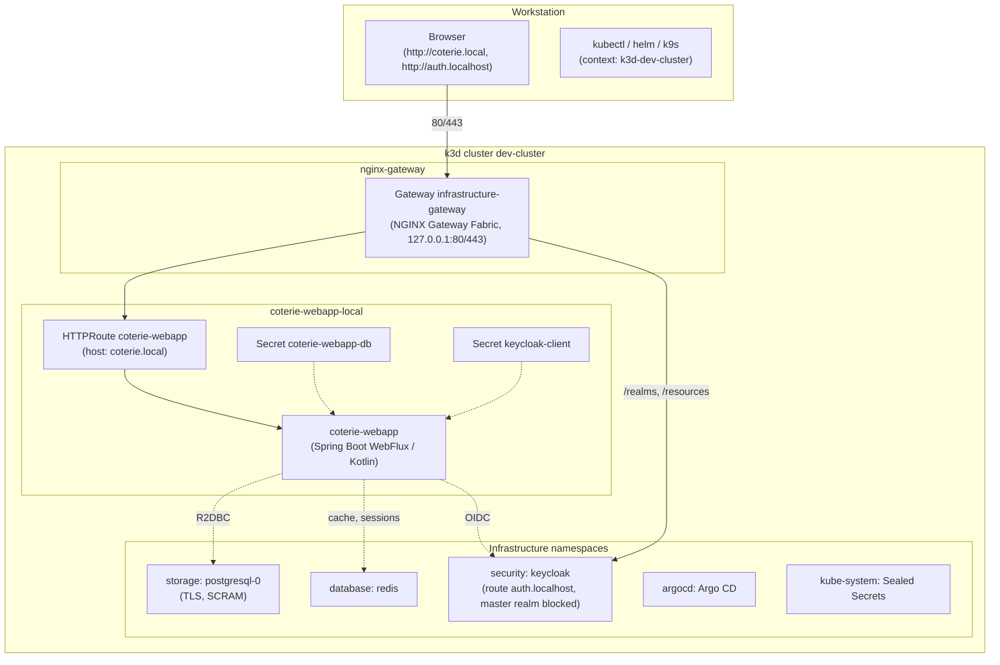

# Local mirror of the VPS stack (k3d)

A local Kubernetes cluster built with [k3d](https://k3d.io/) that mirrors the VPS
platform: same K3s release and flags, same Gateway API controller, same PostgreSQL
configuration (TLS, SCRAM), same Keycloak manifest and routes, same GitOps and secret
controllers. Versions come from [`../vps/config/versions.env`](../vps/config/versions.env),
shared with the VPS.

## Architecture



## Prerequisites

| Tool | macOS |
|------|-------|
| Docker (Docker Desktop or OrbStack) | running |
| k3d 5.8+ | `brew install k3d` |
| kubectl | `brew install kubectl` |
| helm 3.14+ | `brew install helm` |
| envsubst (templates) | `brew install gettext` |

The scripts run with the bash 3.2 of macOS.

## Quick start

```bash
./local/install.sh                  # Gateway API, PostgreSQL, Redis, Argo CD, Sealed Secrets
./local/install.sh --all            # plus Keycloak and Prometheus/Grafana
./local/deploy-app.sh               # coterie-webapp on http://coterie.local
./local/uninstall.sh                # delete everything
```

Makefile shortcuts: `make local-install`, `make local-deploy-apps`, `make local-uninstall`.

## Scripts

### `install.sh`

```text
./local/install.sh [options]
```

| Option | Effect |
|--------|--------|
| `--minimal` | Gateway API, PostgreSQL, Redis, Argo CD, Sealed Secrets (default) |
| `--all` | everything, Keycloak and Prometheus/Grafana included |
| `--with-keycloak` | Keycloak in `security` (~1 GB RAM), routed on http://auth.localhost |
| `--with-monitoring` | Prometheus and Grafana in `monitoring` |
| `--skip-argocd` | no Argo CD |
| `--skip-postgres` | no PostgreSQL (incompatible with Keycloak) |
| `--skip-redis` | no Redis |
| `--recreate` | delete and recreate the cluster when it exists |
| `-y`, `--yes` | no confirmation prompt (with `--recreate`) |

The script is idempotent: run it again to add a component. It warns when an existing
cluster runs another K3s release than `K3S_VERSION` (`--recreate` aligns it).
Version overrides work as on the VPS: `K3S_VERSION=... ./local/install.sh --recreate`.

### `deploy-app.sh`

```text
./local/deploy-app.sh
```

Deploys `../coterie-webapp/helm/coterie-webapp` with `values-local.yaml`: PostgreSQL role
and database `coterie-webapp-local`, Secrets `coterie-webapp-db` and `keycloak-client`,
then the Helm release. The image is pulled from GHCR: create the Secret `ghcr-secret` in
`coterie-webapp-local` first
(`kubectl create secret docker-registry ghcr-secret --docker-server=ghcr.io ...`), or point
`values-local.yaml` to a local image loaded with `k3d image import`. Add
`127.0.0.1 coterie.local` to `/etc/hosts`.

### `uninstall.sh`

```text
./local/uninstall.sh [--keep-data] [-y]
```

| Option | Effect |
|--------|--------|
| `--keep-data` | keep the volume `k3d-dev-storage` and the passwords (they match the stored data) |
| `-y`, `--yes` | no confirmation prompt |

## Parity with the VPS

| Component | Local (k3d) | VPS | Notes |
|-----------|-------------|-----|-------|
| K3s | v1.37.2+k3s1, secrets encrypted | same | `rancher/k3s` image passed by `install.sh` |
| Gateway API CRDs | v1.6.3 (shipped with K3s) | same | |
| NGINX Gateway Fabric | 2.8.1 | same | `local/manifests/infrastructure-gateway.yaml`: HTTP listener only |
| PostgreSQL | chart 18.12.18, image digest of the VPS | same | `vps/values/postgresql.yaml` then `local/values/postgresql.yaml` |
| Keycloak | 26.8.2, same manifest and routes | same | HTTP on `auth.localhost` instead of HTTPS |
| Argo CD | chart 10.17.1 | same | |
| Sealed Secrets | chart 2.22.0 | same | |
| Prometheus / Grafana | charts 29.47.0 / 10.5.15 | same (plus Loki, Promtail, Alertmanager rules) | `local/values/` |
| Redis | 7 | same | |

Local exceptions: no firewall, no TLS on the Gateway (no cert-manager), no audit log, no
NetworkPolicies, no Pod Security labels, no backups. Ports are published on 127.0.0.1
only. The `prometheus-config-reloader` image is overridden with a multi-arch release for
Apple Silicon (`local/values/prometheus.yaml`).

## Secrets and passwords

| File | Content |
|------|---------|
| `local/postgres_password.txt` | PostgreSQL superuser, `coterie-webapp-local` and `keycloak` roles |
| `local/keycloak_password.txt` | Keycloak `admin` user |
| `local/argocd_password.txt` | Argo CD `admin` user |
| `local/secrets/sealed-secrets-pub.pem` | public certificate of the **local** cluster |

They are ignored by git. The passwords are generated on first use and deleted by
`uninstall.sh` (except with `--keep-data`); the certificate is rewritten by every
installation. It only seals secrets for the local cluster: production secrets are sealed
with the VPS certificate (`vps/scripts/export-secrets.sh export-cert`).

## Database strategy

One PostgreSQL instance in `storage`, a dedicated role and database per application and
environment (`<app>-<env>`), the connection settings in a Secret of the application
namespace. One instance uses ~350 MB of RAM; one database pod per environment would not
fit on a 4-6 GB server, and a single backup job covers every database.

## Access

```bash
kubectl config use-context k3d-dev-cluster

kubectl port-forward -n argocd svc/argocd-server 8443:80     # http://localhost:8443, admin / local/argocd_password.txt
kubectl port-forward -n security svc/keycloak 8080:80        # http://localhost:8080/admin, admin / local/keycloak_password.txt
kubectl port-forward -n monitoring svc/grafana 3000:80       # http://localhost:3000, admin / admin (local values)
kubectl exec -it -n database deploy/redis -- redis-cli
```

PostgreSQL (the password stays in the pod):

```bash
kubectl exec -it -n storage postgresql-0 -c postgresql -- \
    sh -c 'PGPASSWORD="$(cat /opt/bitnami/postgresql/secrets/postgres-password)" exec psql -h 127.0.0.1 -U postgres'
```
